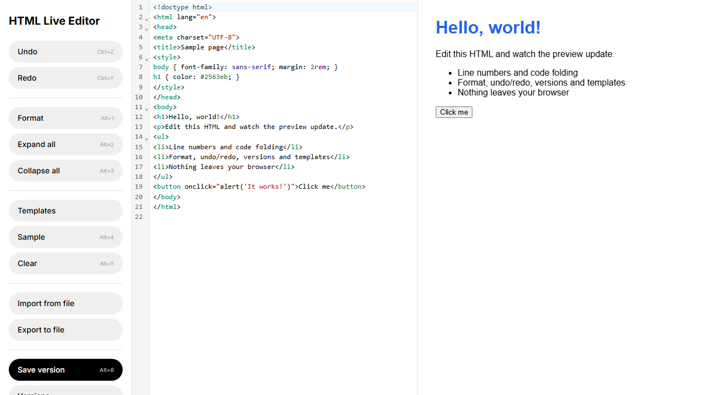

# HTML Live Editor

Editor de HTML com pré-visualização ao vivo, direto no navegador, sem servidor. Undo/redo, versionamento com comparação lado a lado, e uma biblioteca de templates organizada por pasta e tag.

> Projeto de portfólio, inspirado no conjunto de funcionalidades de ferramentas como o html.onlineviewer.net. Nenhum código ou recurso visual do site original foi copiado: o editor usa CodeMirror 6 (o site original usa Ace), e toda a interface, estilo e lógica foram escritos do zero. O visual segue um sistema de design próprio (paleta preto e branco, botões em pílula, tipografia Inter), inspirado na linguagem visual de apps de transporte como a Uber, adaptado para uma ferramenta de produtividade em vez de uma página de marketing.



## Por que este projeto existe

Ferramentas desse tipo parecem simples, mas escondem alguns detalhes que valem a pena fazer direito: uma pré-visualização de HTML arbitrário precisa rodar isolada do resto da página (o HTML digitado pode conter `<script>`), sincronizar duas telas sem servidor exige a API certa, e comparar duas versões de um documento é um problema de diff, não de `string === string`. Este repositório resolve os três.

## Funcionalidades

| Botão            | Atalho   | O que faz                                                                                                                   |
| ---------------- | -------- | --------------------------------------------------------------------------------------------------------------------------- |
| Undo / Redo      | Ctrl+Z/Y | Desfaz e refaz mudanças (histórico nativo do CodeMirror)                                                                    |
| Format           | Alt+1    | Formata o HTML (js-beautify)                                                                                                |
| Expand all       | Alt+2    | Desfaz todo o dobramento de código                                                                                          |
| Collapse all     | Alt+3    | Dobra todo bloco dobrável                                                                                                   |
| Templates        |          | Abre a biblioteca de templates, filtrável por pasta e por tag                                                               |
| Sample           | Alt+4    | Insere um HTML de exemplo                                                                                                   |
| Clear            | Alt+5    | Limpa o editor                                                                                                              |
| Import from file |          | Carrega um arquivo `.html` local no editor                                                                                  |
| Export to file   |          | Baixa o conteúdo atual como `.html`                                                                                         |
| Save version     | Alt+6    | Salva um snapshot nomeado do conteúdo atual                                                                                 |
| Versions         |          | Lista as versões salvas: restaurar, remover, ou comparar com o conteúdo atual (diff lado a lado)                            |
| Live preview     | Alt+7    | Abre a pré-visualização em uma nova aba ou janela que continua atualizando em tempo real, para deixar em um segundo monitor |
| Dark mode        |          | Alterna o tema do editor e da pré-visualização, persistido em `localStorage`                                                |

O conteúdo do editor também é salvo automaticamente em `localStorage`, então recarregar a página não perde o trabalho.

## Versionamento e comparação

"Save version" grava um snapshot do conteúdo atual (com um nome opcional) numa lista local. "Versions" lista tudo o que foi salvo; "Comparar com atual" abre um diff lado a lado entre a versão salva e o que está no editor agora, usando `@codemirror/merge`, o pacote oficial do próprio CodeMirror para isso, em vez de um diff feito à mão.

## Templates

Uma pequena biblioteca de templates iniciais (landing page, formulário de contato, tabela de dados, card de produto, e-mail HTML), organizados por pasta e por tag, pensada para crescer com o tempo. Adicionar um novo template é editar um array em `src/templates.ts`: não precisa mexer na UI do painel.

## Decisões de segurança

- **Pré-visualização isolada:** o iframe da pré-visualização usa `sandbox="allow-scripts allow-forms allow-popups"`, sem `allow-same-origin`. Um script no HTML do usuário roda, mas em uma origem opaca, sem acesso ao DOM da página principal.
- **Sincronização entre abas sem servidor:** o Live preview usa `BroadcastChannel`, que só entrega mensagem entre abas da mesma origem, no mesmo navegador. Nenhum conteúdo do editor sai da máquina do usuário, nem para sincronizar as duas telas.
- **Versões e templates nunca viram `innerHTML` direto:** tanto o rótulo de uma versão salva quanto o nome de um template passam por `escapeHtml` antes de entrar no DOM da lista, mesmo sendo dado que o próprio usuário digitou.

## Rodando localmente

```bash
npm install
npm run dev       # http://localhost:5173
```

## Testes

```bash
npm test              # Vitest, lógica pura (format, fileIO, versions, templates, debounce)
npm run test:coverage
npm run test:e2e      # Playwright, contra a aplicação real rodando
```

## Limitações conhecidas (honestidade > esconder)

- O bundle final inclui o CodeMirror com suporte a HTML e ao merge view, então fica em torno de 200KB gzipado. Não há nenhum recurso carregado sob demanda no momento: o diff e os templates são pequenos o bastante para não justificar `import()` dinâmico ainda.
- Live preview funciona entre abas ou janelas do mesmo navegador, na mesma origem. Não funciona entre navegadores diferentes, nem entre dispositivos diferentes.
- Versões e conteúdo autosalvo ficam em `localStorage`, por navegador e por origem: limpar os dados do site apaga tudo, e não há sincronização entre máquinas.
- Não há teste automatizado de Expand/Collapse all: a asserção visual de dobramento de código no CodeMirror não tem uma forma limpa de verificar via DOM sem acoplar o teste aos detalhes internos da extensão de fold.

## Licença

MIT. Ver [LICENSE](LICENSE).
